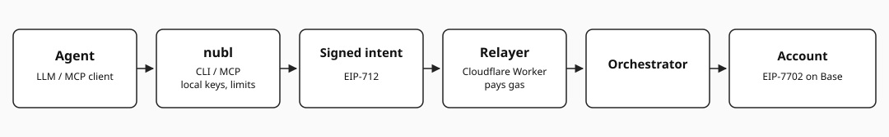
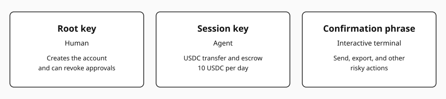

<p align="center">
  <picture>
    <source media="(prefers-color-scheme: dark)" srcset="docs/assets/logo-dark.svg">
    
  </picture>
</p>

<p align="center">Wallets and payments for AI agents on Base.</p>

<p align="center">
  <a href="https://www.npmjs.com/package/@nubl/wallet"></a>
  <a href="https://github.com/nublai/payments/actions"></a>
  <a href="LICENSE"></a>
  <a href="docs/site"></a>
</p>

<p align="center">
  
</p>

## Install

The CLI command is `nubl`. `@nubl/wallet` is set up to publish (`publishConfig.access` is `public`) and is not on the npm registry, so this page does not use `npm i`.

From a checkout:

```bash
bun install
bun ./packages/wallet/src/cli.ts --help
```

## Quickstart

`--env` is required: `prod`, `stage`, or `dev`. `--env dev` uses `http://127.0.0.1:8787` unless `RELAYER_URL_DEV` is set. `account create` asks for `CREATE FULL ACCESS SESSION`. `send` asks for `SEND USDC`. Both phrases are typed on an interactive terminal.

```bash
nubl account create --env dev
nubl send 1 0x1111111111111111111111111111111111111111 --env dev
```

`nubl --mcp` starts the stdio MCP server:

```json
{
  "mcpServers": {
    "nubl": {
      "command": "nubl",
      "args": ["--mcp"]
    }
  }
}
```

From a checkout, before `nubl` is on `PATH`, the same server is `bun ./packages/wallet/src/cli.ts --mcp`.

## Features

- EIP-7702 account on Base. The Orchestrator executes a signed intent.
- A new account gets a narrow session: USDC transfer and approve, escrow, refund, settler write, escrow settle, and 10 USDC per day.
- Send, key export, and other risky actions need a confirmation phrase typed on an interactive terminal. MCP cannot type it.
- The relayer is a Cloudflare Worker and pays gas. Off local chains the account pays the fee in USDC.
- USDC escrow: create, status, settle, and refund.
- Swap and bridge go through relay.link and need their own session.

## Packages

| Path | Package | What it is |
| --- | --- | --- |
| `packages/wallet` | `@nubl/wallet` | CLI `nubl` and the MCP server |
| `packages/relayer-client` | `@nubl/relayer-client` | viem-style client: `prepareCalls`, `sendPreparedCalls`, `upgradeAccount`, escrow helpers |
| `packages/contracts` | `@nubl/contracts` | Solidity: Account, Orchestrator, GuardedExecutor, Escrow, and the funder, settler, and simulator |
| `packages/relayer` | `@nubl/relayer` | Cloudflare Worker that submits signed intents |
| `packages/proto` | `@nubl/proto` | `BearerToken`, `WalletSessionToken`, and `ExportedDevice` |

## Security

The root key stays with a person. The session key an agent uses is the narrow daily USDC session above. Sending funds, exporting keys, and the other actions in the diagram need a phrase typed on an interactive terminal; MCP and a non-TTY `nubl` are refused before they sign. Report a vulnerability through [SECURITY.md](SECURITY.md).

<p align="center">
  
</p>

## Docs

The docs site will live in [`docs/site`](docs/site). It is not hosted yet. Limits, MCP tool ids, confirmation phrases, env vars, and signing details are in [docs/reference.md](docs/reference.md).

## Development

```bash
bun install
bun run e2e:local-payment
```

Ports 8545, 8546, and 8787 must be free. Local escrow is `bun run e2e:local-escrow`. Stage launch notes: [docs/runbooks/base-sepolia-launch.md](docs/runbooks/base-sepolia-launch.md).

## Contributing

See [CONTRIBUTING.md](CONTRIBUTING.md).

## License

[MIT](LICENSE)
